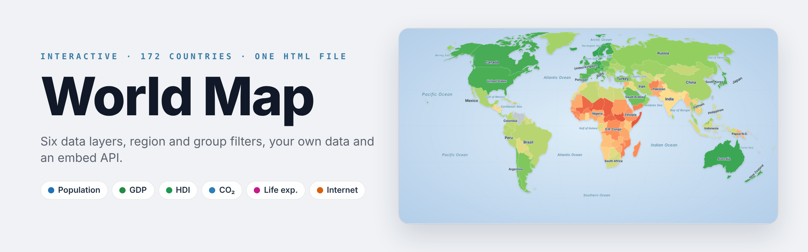
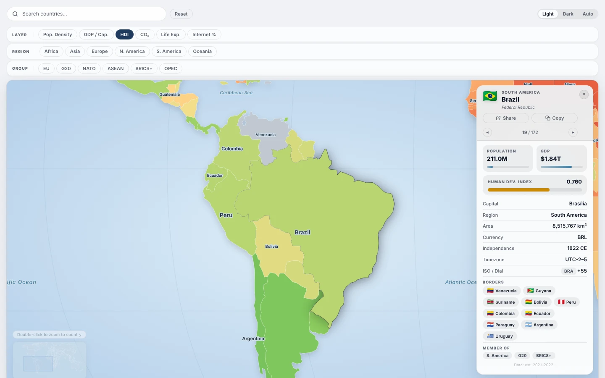
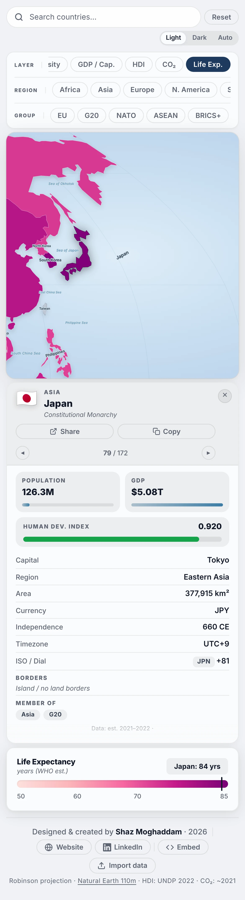
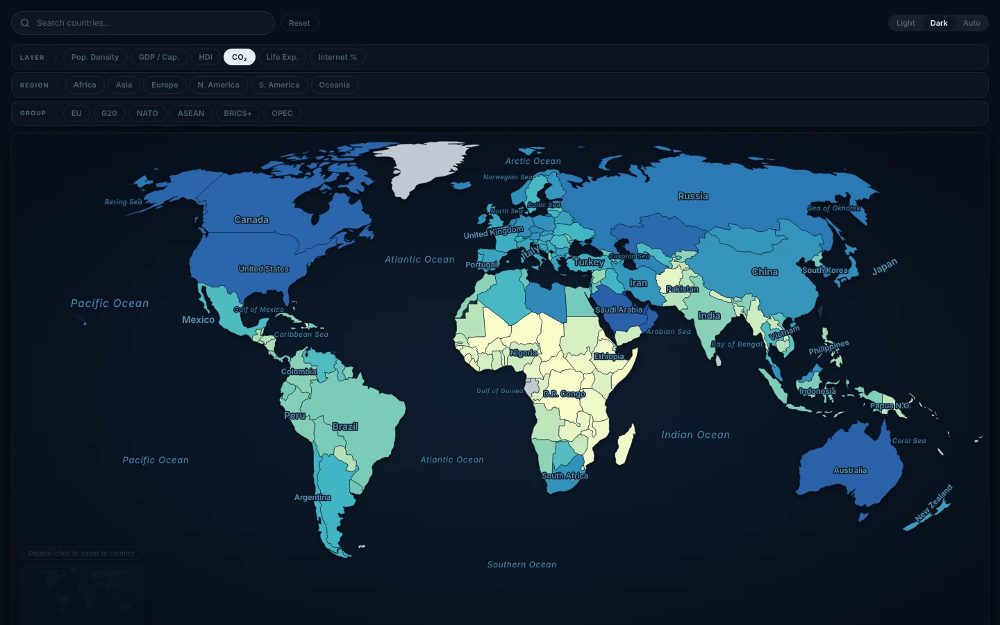

<p align="center">
  <a href="https://shazmoghaddam.github.io/world-map/">
    
  </a>
</p>

# World Map

[](https://github.com/ShazMoghaddam/world-map/actions/workflows/ci.yml)
[](LICENSE)
[](CHANGELOG.md)
[](https://shazmoghaddam.github.io/world-map/)


An interactive world map in a single HTML file. Explore six data layers for 172 countries, filter by region or political group, import your own data and embed it anywhere. No libraries, no server, no build step.

**[Open the live demo →](https://shazmoghaddam.github.io/world-map/)**

**Contents:** [Features](#features) · [Screenshots](#screenshots) · [Data layers](#data-layers) · [Import your own data](#import-your-own-data) · [Keyboard shortcuts](#keyboard-shortcuts) · [Embedding](#embedding) · [Map details](#map-details) · [Run it](#run-it) · [Layout](#layout)

## Features

- **172 countries**, each with a detail panel: population, GDP, HDI, capital, currency, borders, groups and more.
- **Six data layers:** population density, GDP per capita, Human Development Index, CO₂ per person, life expectancy and internet use.
- **Filter by region** (Africa, Asia, Europe, North America, South America, Oceania) **or group** (EU, G20, NATO, ASEAN, BRICS+, OPEC).
- **Your own data.** Drop a CSV or JSON file on the map to colour it by any value.
- **Shareable links.** The selected country and layer live in the URL, for example `?c=GBR&layer=hdi`.
- **Embeddable**, with a message API so the page around it can control the map.
- **Works everywhere:** zoom and pan with mouse, trackpad, touch or keyboard; light, dark or automatic theme.

## Screenshots

<table>
  <tr>
    <td width="66%"></td>
    <td width="34%" rowspan="2"></td>
  </tr>
  <tr>
    <td></td>
  </tr>
</table>

## Data layers

| Layer | Source | Year | Scale |
|---|---|---|---|
| Population density | World Bank / UN | about 2022 | Logarithmic |
| GDP per capita | World Bank / IMF | about 2022 | Logarithmic |
| Human Development Index | UNDP | 2022 | Linear |
| CO₂ per person | Global Carbon Project | about 2021 | Logarithmic |
| Life expectancy | WHO / World Bank | about 2022 | Linear |
| Internet use | ITU | about 2022 | Linear |

> The figures are rounded estimates built into the file. They are not live, and newer figures exist for most layers.

Each legend's ticks sit at their true positions on the scale, so on the logarithmic layers equal steps are equal ratios.

## Import your own data

Drop a file anywhere on the map, or use **Import data** in the footer. Countries are matched by [ISO 3166-1 alpha-3](https://en.wikipedia.org/wiki/ISO_3166-1_alpha-3) code, and values are scaled from lowest to highest.

**CSV**

```csv
ISO3,Value
USA,0.92
GBR,0.87
DEU,0.95
```

**JSON**

```json
{ "USA": 0.92, "GBR": 0.87, "DEU": 0.95 }
```

Your file never leaves your browser.

## Keyboard shortcuts

| Key | Action |
|---|---|
| `←` `→` | Previous / next country (panel open), or pan (panel closed) |
| `↑` `↓` | Pan the map |
| `+` / `=` | Zoom in |
| `-` / `_` | Zoom out |
| `R` | Reset the view and layer |
| `L` | Cycle through the data layers |
| `Esc` | Close the panel, clear the search or clear the filter |

## Embedding

Click **Embed** in the footer to copy an iframe for the current view:

```html
<iframe
  src="https://shazmoghaddam.github.io/world-map/?c=GBR&layer=hdi"
  width="100%" height="600" style="border:none;border-radius:8px"
  title="World Map" loading="lazy"></iframe>
```

### Control it from your page

Send messages to the iframe. Only the page that embeds the map can control it.

```js
const map = document.querySelector('iframe').contentWindow;

map.postMessage({ type: 'select', iso: 'FRA' }, '*');     // select and fly to a country
map.postMessage({ type: 'setMode', mode: 'co2' }, '*');   // density, gdppc, hdi, co2, lifeexp, internet
map.postMessage({ type: 'setFilter', group: 'EU27' }, '*');
map.postMessage({ type: 'setTheme', theme: 'dark' }, '*'); // light, dark or auto
map.postMessage({ type: 'reset' }, '*');

// The map tells you when a country is picked
window.addEventListener('message', e => {
  if (e.data?.type === 'countrySelected') console.log(e.data.name, e.data.data);
});
```

The map also sends `ready` when it loads and `countryDeselected` when the panel closes. Other commands: `flyTo`, `clearFilter`, `choropleth` (your own `values`, plus `lo` and `hi` colours) and `resetColors`.

If the map runs on the same site as your page, you can also call `contentWindow.WorldMap` directly (`select`, `flyTo`, `zoomToFit`, `setMode`, `setFilter`, `clearFilter`, `reset`, `setTheme`, `onSelect`).

## Map details

- **Projection:** Robinson, a compromise that keeps overall distortion low.
- **Geometry:** [Natural Earth 110m](https://www.naturalearthdata.com/) (public domain).
- **Disputed territories:** Western Sahara, Palestine, Taiwan, Cyprus and Kosovo are drawn with a dashed border and a short notice.
- **Phones:** the map gets a taller frame that you pan around, and the country panel sits below it instead of covering it.

## Run it

Open `index.html` in a browser. That's it.

To run the tests or rebuild the images, you need Node 20 or later:

```bash
npm install
npx playwright install chromium
npm test                 # smoke tests: widths, every layer, links, phone panel, import
npm run build:assets     # banner, social preview and screenshots
```

## Layout

```
index.html              the whole map: markup, styles, data and script
assets/
  banner.png            README banner
  social-preview.png    GitHub social preview (Settings > Social preview)
  screenshots/          README screenshots
  build.mjs             builds all of the above from the live map
scripts/serve.mjs       tiny static server used by the build and tests
tests/smoke.mjs         headless browser tests, run in CI
```

## Licence

[MIT](LICENSE). Map geometry from Natural Earth (public domain).

---

Created by **Shaz Moghaddam** · London  
[Website](https://shazmoghaddam.github.io/) · [LinkedIn](https://www.linkedin.com/in/shazmoghaddam/)
